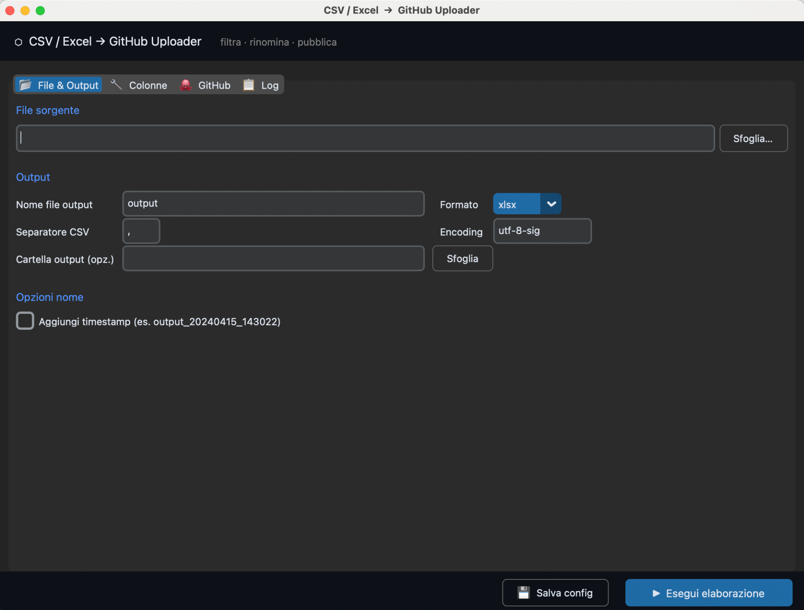
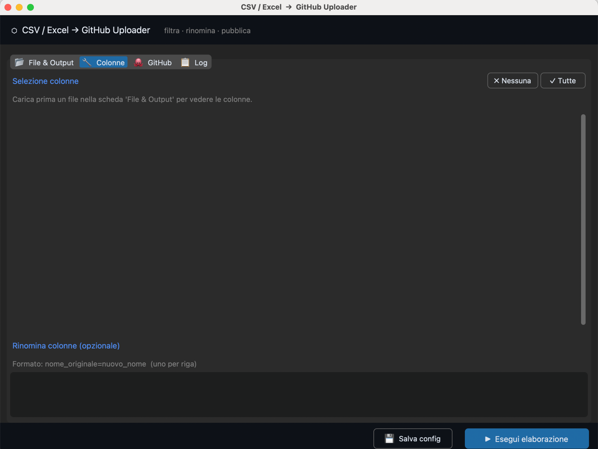
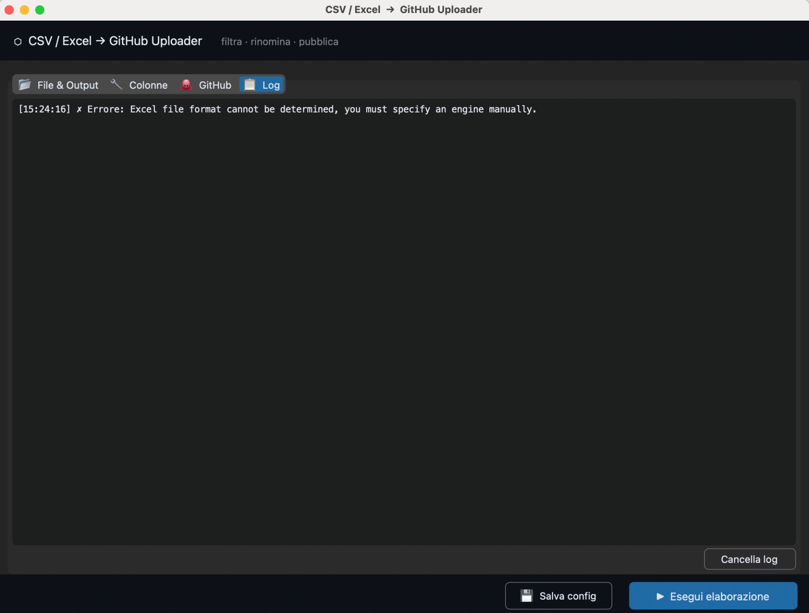

# CSV / Excel → GitHub Uploader

**Prepara e pubblica file Excel e CSV su GitHub, senza usare il terminale.**

CSV / Excel → GitHub Uploader è un'applicazione desktop per Windows e macOS che permette di selezionare le colonne di un file tabellare, rinominarle, configurare l'output e caricare il risultato in un repository GitHub.

L'applicazione viene distribuita come **eseguibile standalone**: chi la utilizza non deve installare Python.

## Perché nasce questo progetto?

In molti uffici amministrativi e contesti aziendali si lavora ogni giorno con fogli Excel e file CSV, talvolta di dimensioni considerevoli. Pubblicare questi dati su GitHub può richiedere strumenti e procedure che non fanno parte del lavoro quotidiano di chi gestisce i dati: Git, terminale, configurazione del repository e autenticazione.

**Non dovrebbe essere necessario conoscere gli strumenti di sviluppo per condividere un dataset.**

Questo progetto nasce per rendere più accessibile il processo: le operazioni principali sono raccolte in un'interfaccia desktop, pensata anche per chi non ha competenze specifiche nell'uso di Git.

> **Nota sui file di grandi dimensioni:** il programma consente di selezionare ed esportare solo le colonne necessarie, una funzione che può ridurre le dimensioni del file finale. Non è però documentato un meccanismo per superare il limite di 100 MB per singolo file dei normali repository GitHub. Prima di pubblicizzare il supporto al caricamento di file superiori a tale limite, occorre verificare il comportamento effettivo dell'applicazione.

## Funzionalità

| Scheda | Funzioni |
| --- | --- |
| 📂 **File & Output** | Apertura di file `.xlsx`, `.xls`, `.csv` e `.tsv`; configurazione di nome, formato, encoding, cartella di output e timestamp |
| 🔧 **Colonne** | Selezione delle colonne tramite checkbox, selezione rapida e rinomina con sintassi `vecchio=nuovo` |
| 🐙 **GitHub** | Configurazione di token, repository, branch, percorso di destinazione e messaggio di commit; test della connessione |
| 📋 **Log** | Registro delle operazioni con timestamp |

La configurazione viene salvata automaticamente nel file `~/.csv_github_uploader_config.json`.

## Screenshot dell’applicazione

### File & Output
Configura il file sorgente, il formato di esportazione e il nome del risultato.



### Colonne
Seleziona le colonne da mantenere e definisci eventuali rinomine.



### Log
Consulta il registro delle operazioni e i messaggi dell'applicazione.


### Esempio di messaggio di errore
La schermata seguente mostra un errore di riconoscimento del formato Excel: è un esempio diagnostico, non una procedura completata correttamente.



## A chi si rivolge?

- **Personale amministrativo e operativo** che lavora con file Excel e CSV e deve condividerli tramite GitHub.
- **Data analyst e ricercatori** che vogliono preparare dataset selezionando solo le colonne utili.
- **Team tecnici** che desiderano mettere a disposizione dei colleghi uno strumento desktop, senza richiedere l'uso del terminale.

## Come iniziare

### Windows

Scarica `CSVGitHubUploader.exe` dalla distribuzione del progetto e avvialo con un doppio clic. **Non è necessario installare Python.**

### macOS

Scarica `CSVGitHubUploader.app` dalla distribuzione del progetto e spostala nella cartella Applicazioni. Se macOS blocca l'avvio di un'app non firmata, segui le indicazioni di sicurezza del sistema e aprila solo se proviene da una fonte attendibile.

### Flusso di lavoro

1. Apri un file Excel o CSV nella scheda **File & Output**.
2. Seleziona le colonne che vuoi mantenere nella scheda **Colonne** e, se necessario, rinominale.
3. Configura il file di output.
4. Nella scheda **GitHub**, imposta repository, branch, percorso e token di accesso.
5. Verifica la connessione e avvia il caricamento; consulta la scheda **Log** per seguire le operazioni.

## Configurare l'accesso a GitHub

Per consentire all'applicazione di scrivere nel repository, crea un **Personal Access Token (fine-grained)**:

1. Apri GitHub → **Settings** → **Developer settings** → **Personal access tokens** → **Fine-grained tokens**.
2. Seleziona esclusivamente il repository necessario e assegna il permesso **Contents: Read and write**.
3. Inserisci il token nella scheda **GitHub** dell'applicazione.

**Sicurezza:** tratta il token come una password. Non inserirlo nel repository, non condividerlo e non pubblicare il file di configurazione. Poiché il README originale non specifica come venga conservato il token, è opportuno verificare nel codice se sia salvato in chiaro e, in tal caso, valutare una soluzione più sicura.

## Compilare l'applicazione

Le istruzioni seguenti sono destinate a chi prepara i binari da distribuire. Gli utenti finali non devono eseguire questi passaggi.

La compilazione va effettuata separatamente su ciascun sistema operativo.

### Windows

**Prerequisito:** Python 3.8+ da [python.org](https://www.python.org/downloads/). Durante l'installazione, abilita **Add Python to PATH**.

Esegui `build_windows.bat` con un doppio clic.

Output previsto: `dist\CSVGitHubUploader.exe` (dimensione indicativa: 60–80 MB).

### macOS

**Prerequisito:** Python 3.8+ da [python.org](https://www.python.org/downloads/macos/).

```bash
chmod +x build_mac.sh
./build_mac.sh
```

Output previsto: `dist/CSVGitHubUploader.app` (dimensione indicativa: 80–100 MB; comprimibile in ZIP per la distribuzione).

**Nota:** per una distribuzione macOS senza i consueti avvisi per applicazioni non identificate, valuta firma del codice e notarizzazione Apple. Le procedure disponibili dipendono dalla modalità di distribuzione.

## Filosofia del progetto

**La tecnologia dovrebbe adattarsi alle esigenze delle persone, non costringere le persone a diventare esperte di strumenti tecnici.**

CSV / Excel → GitHub Uploader vuole semplificare il percorso tra un foglio di calcolo e un repository GitHub, rendendo più accessibile la pubblicazione dei dati a chi li usa quotidianamente.

